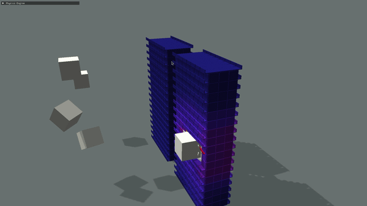
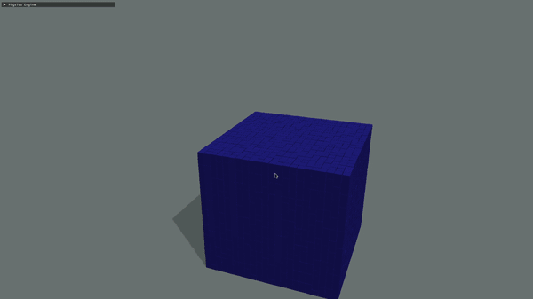
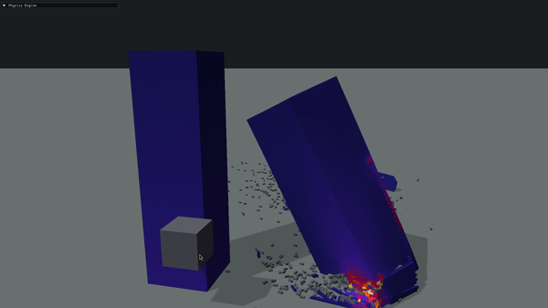
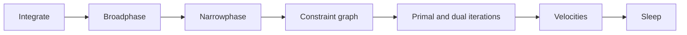

# AVBD 3D Physics Engine (Vulkan)

A rigid-body physics engine that runs the whole simulation step on the GPU through Vulkan compute, with a C API.

**Status: experimental, waiting for human review, v1.0.0, ABI 1.0.** Tested on Windows 10 with an NVIDIA GPU and on Linux (Fedora, GCC, Mesa RADV). macOS (MoltenVK) is an intended target and has not been built or run. See [limitations](docs/limitations.md).





## What it is

The solver is Augmented Vertex Block Descent (AVBD): an implicit-Euler method that solves each body's 6x6 system and updates contact and joint penalties with multipliers. It was designed for stable stacks, large mass ratios and breakable joints at few iterations.

Each step is one Vulkan queue submission. Body state stays on the device. The public API is plain C99, three headers, one shared library.

Measured on an RTX 4070 SUPER with sleep off, 8 iterations: a perturbed pile of 10,000 bodies takes 1.88 ms per step and 100,000 bodies take 13.46 ms. These figures were taken earlier on the same solver code; see [when to use it](docs/when-to-use.md).

## Features

| Area | Supported |
| :--- | :--- |
| Shapes | Sphere, capsule, convex hull, box, triangle mesh, height field, compound |
| Bodies | Static, kinematic, dynamic; sleeping; continuous collision; motion locks |
| Joints | Distance, motor, prismatic, revolute, spherical, weld, wheel, parallel, filter; generic six-axis joint with limits, motors, springs and fracture; springs |
| Contacts | Friction, restitution, rolling resistance, sensors, 64-bit category and mask filters |
| Events | Contact begin, end and hit; sensor; body move; joint |
| Queries | Ray, shape cast, overlap, per-body queries, character mover |
| Extras | Explosions, mouse grab, GPU instance buffer for rendering |

## Build

Requirements are in [docs/requirements.md](docs/requirements.md): CMake, Ninja, a C++17 compiler, the Vulkan SDK (for `slangc`) and Python 3. SDL and imgui are git submodules.

```bash
git clone --recursive https://github.com/5weetdev/AVBD-3D-Physics-Engine-Vulkan.git
cd AVBD-3D-Physics-Engine-Vulkan
```

| Platform | Command |
| :--- | :--- |
| Windows | `build.bat release test` |
| Linux, macOS | `./build.sh release test` |

Arguments: `release` or `debug`, then optionally `clean`, `test`, `run`. Output goes to `build/release` or `build/debug`.

| CMake option | Default | Builds |
| :--- | :--- | :--- |
| `AVBD3D_BUILD_DEMO` | ON | `avbd3d_demo` |
| `AVBD3D_BUILD_TESTS` | ON | `avbd3d_test_*` |
| `AVBD3D_BUILD_EXAMPLES` | ON | `avbd3d_hello` |

## Quickstart

```c
#include "avbd3d/avbd3d.h"
#include "avbd3d/avbd3d_geometry.h"
#include <stdio.h>

int main(void)
{
    Avbd3dWorldDef wd = avbd3d_default_world_def();
    Avbd3dWorld *world = NULL;
    if (avbd3d_create_world(&wd, &world) != AVBD3D_OK) return 1;

    Avbd3dBoxHull hull = avbd3d_make_box_hull(0.5f, 0.5f, 0.5f);
    Avbd3dBodyDef bd = avbd3d_default_body_def();
    bd.type = AVBD3D_DYNAMIC_BODY;
    bd.position.y = 3.0f;
    Avbd3dBodyId box;
    avbd3d_create_body(world, &bd, &box);
    Avbd3dShapeDef sd = avbd3d_default_shape_def();
    Avbd3dShapeId shape;
    avbd3d_create_hull_shape(box, &sd, avbd3d_box_hull_data(&hull), &shape);

    for (int i = 0; i < 60; i++) avbd3d_step(world, 1.0f / 60.0f);

    Avbd3dVec3 p;
    avbd3d_body_get_position(box, &p);
    printf("y = %g\n", (double)p.y);
    avbd3d_destroy_world(world);
    return 0;
}
```

The complete example with a ground is [examples/hello.c](examples/hello.c). A walkthrough is in [getting started](docs/getting-started.md).

## How a step works



All phases are recorded into one command buffer. Details: [architecture](docs/architecture.md).

## Known limits

| Limit | Detail |
| :--- | :--- |
| Mesh against mesh | Not tested for collision |
| Height fields | Static only |
| Determinism | Not guaranteed |
| Platforms | Tested on Windows (NVIDIA) and Linux (AMD, Mesa RADV); macOS is untested |
| Threads | A world is not thread safe |

The full table with workarounds is [docs/limitations.md](docs/limitations.md).

## Documentation

| Page | Contents |
| :--- | :--- |
| [requirements](docs/requirements.md) | Toolchain, build, install |
| [getting started](docs/getting-started.md) | `hello.c` line by line |
| [concepts](docs/concepts.md) | Units, ids, defs, results, stepping, events |
| [API cheatsheet](docs/api-cheatsheet.md) | Calls by task |
| [shapes and joints](docs/shapes-and-joints.md) | Support matrices |
| [architecture](docs/architecture.md) | Layers, one step, capacity rerun |
| [when to use it](docs/when-to-use.md) | Fit and measured cost |
| [limitations](docs/limitations.md) | Gaps and workarounds |
| [troubleshooting](docs/troubleshooting.md) | Symptoms and fixes |

## AI assistance

This project was developed with substantial help from AI coding assistants (Claude). The author reviewed and directed the work. Treat it as experimental and test it for your use.

## Maintenance

Maintained on a best-effort basis. Issues are welcome; response time is not guaranteed. See [CONTRIBUTING.md](CONTRIBUTING.md).

## License

MIT. Copyright (c) 2025 Chris Giles, (c) 2026 Olexii Voloshchuk. See [LICENSE](LICENSE) and [THIRD_PARTY_NOTICES.md](THIRD_PARTY_NOTICES.md).

## Credits

- *Augmented Vertex Block Descent*, Chris Giles, Elie Diaz, Cem Yuksel, ACM Transactions on Graphics (SIGGRAPH 2025), 44(4), Article 90. <https://graphics.cs.utah.edu/research/projects/avbd/>
- [Box3D](https://github.com/erincatto/box3d) (Erin Catto): API style and collision code.
- [SDL](https://libsdl.org) and [Dear ImGui](https://github.com/ocornut/imgui) for the demo.
