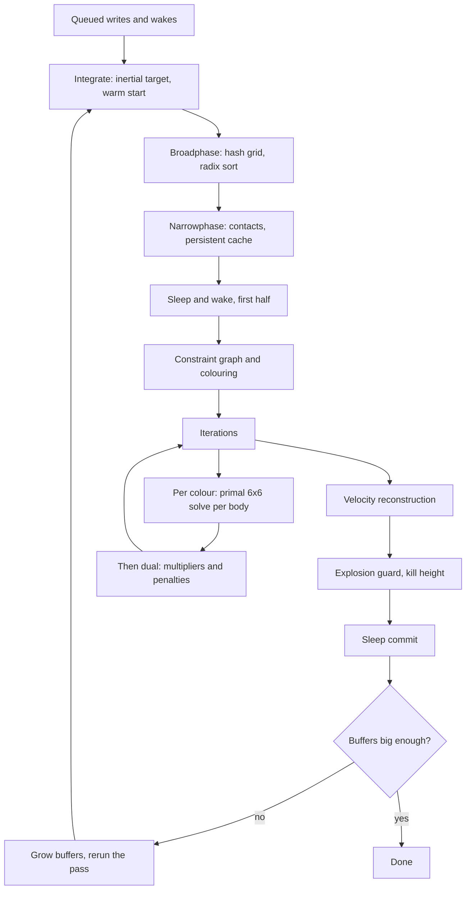

# Architecture

**What you get:** how the source is layered, what one step does, and how the library copes with buffers that turn out too small.

## Layers

Each directory sees only the ones above it. CMake include paths enforce this; there is no checker script.

| Directory | Contents | May include |
| :--- | :--- | :--- |
| `include/avbd3d/` | Public C headers | nothing outside itself |
| `src/core/` | Math, contact types, solver parameters, shared plain-data structs | - |
| `src/scene/` | Scene description the world is built from | core |
| `src/gpu/` | Vulkan device, buffers, pipelines, command recording, scan and sort primitives | core |
| `src/world/` | `VkWorld` and the phase owners (broadphase, narrowphase, constraints, solver, sleep, interaction, render) | core, scene, gpu |
| `src/api/` | The C API: validates arguments, forwards to `VkWorld` | all of the above |
| `src/shaders/` | Slang compute kernels | - |
| `demo/` | SDL2 and ImGui application | public headers only |

## One step

`avbd3d_step` is `avbd3d_step_begin` plus `avbd3d_step_end`. `step_begin` records every phase into one command buffer and submits it once. `step_end` waits and reads a small status block. Body poses are never read back during a step.

| Phase | What it does |
| :--- | :--- |
| Integrate | Computes the inertial target and warm-starts poses |
| Broadphase | Uniform hash grid, radix sort, separate path for oversize bodies |
| Narrowphase | Box, sphere, capsule, hull, mesh and height-field tests. Keeps contacts between steps so multipliers carry over |
| Constraint graph | Body-to-constraint adjacency, then colouring so no two constraints in a colour share a body |
| Primal | For each body in a colour, builds and solves a 6x6 system |
| Dual | Updates multipliers and penalty stiffness, applies the friction cone |
| Tail | Velocity from position change, explosion guard, kill height, sleep decisions |

## Capacity and rerun

Every phase that produces a count (pairs, contacts, manifolds, graph entries, instances) counts what it needs on the device and refuses to write past its buffer. If a count exceeds its buffer, or a bounded loop (wake flood, island flood, colouring rounds) ran out of rounds, `step_end` grows the buffer or widens the bound and runs the pass again. The contact cache survives growth.

| Result | Meaning |
| :--- | :--- |
| `AVBD3D_OK` | Step completed. `Avbd3dStats` reports reruns |
| `AVBD3D_ERR_CAPACITY` | A hard ceiling was reached and the step committed clamped results |
| `AVBD3D_ERR_DEVICE_LOST` | The GPU device was lost. Every later call on that world returns this; destroy it |

## Shaders

Kernels live in `src/shaders/*.slang`. The build compiles each with `slangc`, and `tools/embed_spirv.py` turns the SPIR-V into C arrays linked into the library. No shader files are read at run time. Host-side argument structs in `src/world/vk_args.h` mirror the Slang structs; `avbd3d_test_layout` fails if they disagree.

## Collision code

Convex, mesh and height-field geometry and the host queries come from Box3D (`external/box3d`). Narrowphase kernels generated from it live in `src/shaders/b3/`. See [THIRD_PARTY_NOTICES](../THIRD_PARTY_NOTICES.md).
